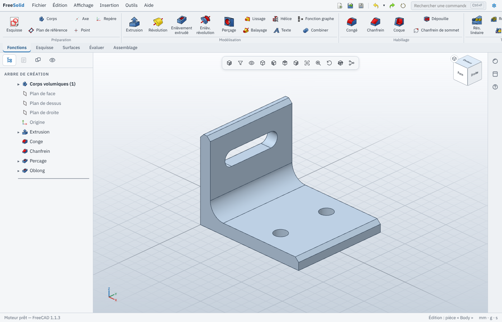

# FreeSolid

A modern mechanical CAD interface on top of an untouched, headless FreeCAD
engine. Your files stay standard `.FCStd` documents that open in FreeCAD.

> **Early prototype.** Usable for simple parts; some features are
> missing or may break, and files may not reopen across versions. Feedback
> is welcome in the [issues](https://github.com/Emilien-Etadam/Freesolid/issues).

<picture>
  <source media="(prefers-color-scheme: dark)" srcset="docs/img/apercu-sombre.png">
  
</picture>

## Download

The desktop app (`desktop/`, built with Tauri) needs no terminal: it finds
FreeCAD on your machine (or offers to install it), runs the engine locally
and updates itself from GitHub releases. Installers for Linux, Windows and
macOS are on the
[releases page](https://github.com/Emilien-Etadam/Freesolid/releases/latest).
Details and the release procedure: [`desktop/README.md`](desktop/README.md).

## Features

- **Sketching** with constraints and a WASM solver (planegcs) running at
  ~60 fps while dragging; offset, mirror, patterns, fillet, trim; splines
  and conics; sketch images (background tracing)
- **Part features**: extrude and cut, revolve, fillet, chamfer, shell,
  draft, hole wizard, loft, sweep, helix, patterns, engraved text
- **Surfaces**: extruded, revolved, lofted, swept, filled and boundary
  surfaces, trim, knit, thicken, freeform — **parametric and editable**
  (double-click, expressions)
- **3D sketches**: splines and polylines in space, snapped to the part,
  with axis, angle and length rules
- **Multi-body parts** with per-body display colors
- **Equations** and expressions (global variables, driven dimensions);
  **configurations** with a configuration table
- **Assemblies**: components, joints, MbD solver, interference check,
  exploded view
- **Drawings**: dimensioned DXF (Front / Top / Iso views), optional X/Y/Z
  section
- **Import/export**: STEP, IGES, STL, 3MF; open and save `.FCStd`
- **`.SLDPRT` parts and Parasolid** (`.x_t`, `.x_b`): opened as plain
  geometry, one body per solid, through the separate
  [OpenSW](https://github.com/Emilien-Etadam/OpenSW) reader — see below

## Run from source

With FreeCAD ≥ 1.0 already installed:

```bash
freecadcmd engine/server.py
# then open http://localhost:8787
```

A single process serves both the JSON API and the static UI (`app/`).

### Linux, step by step (no prerequisites)

Paste this whole block into a terminal. It downloads FreeCAD (~800 MB,
once), fetches FreeSolid and starts the server:

```bash
cd ~
curl -L -o FreeCAD.AppImage https://github.com/FreeCAD/FreeCAD/releases/download/1.1.3/FreeCAD_1.1.3-Linux-x86_64-py311.AppImage
chmod +x FreeCAD.AppImage
./FreeCAD.AppImage --appimage-extract
git clone https://github.com/Emilien-Etadam/Freesolid.git
cd Freesolid
~/squashfs-root/usr/bin/freecadcmd engine/server.py
```

When the terminal prints “FreeSolid engine ready”, open
**<http://localhost:8787>** in your browser.

- To stop: `Ctrl+C` in the terminal.
- Next time, only the last two lines are needed:

  ```bash
  cd ~/Freesolid
  ~/squashfs-root/usr/bin/freecadcmd engine/server.py
  ```

- No `git`? Run `sudo apt install git` (Ubuntu/Debian), or download the
  repository ZIP (**Code → Download ZIP** on GitHub) and unzip it in your
  home folder.

### Windows, step by step

1. Install FreeCAD 1.1.3 from
   [its release page](https://github.com/FreeCAD/FreeCAD/releases/tag/1.1.3)
   (Windows installer `.exe`, default options).
2. On the project's GitHub page: **Code → Download ZIP**, then right-click
   the ZIP → **Extract All** into your `Documents` folder.
3. Open PowerShell (Start menu → type “PowerShell”) and paste:

   ```powershell
   cd $env:USERPROFILE\Documents\Freesolid-main
   & "C:\Program Files\FreeCAD 1.1\bin\freecadcmd.exe" engine\server.py
   ```

   (If FreeCAD is installed elsewhere, adjust the path — look for
   `freecadcmd.exe` in its installation folder.)
4. Open **<http://localhost:8787>** in your browser.

### Opening `.SLDPRT` and Parasolid files

FreeSolid does not decode these formats itself. It runs
[OpenSW](https://github.com/Emilien-Etadam/OpenSW), a separate program
(AGPL-3.0), in its own process. OpenSW writes a STEP file, and FreeSolid
imports that. Only the geometry comes in, one body per solid. The file's
feature tree is not replayed.

```bash
git clone https://github.com/Emilien-Etadam/OpenSW.git   # next to Freesolid/
```

FreeSolid looks for `OpenSW/` next to its own folder. If you cloned it
somewhere else, set `FREESOLID_OPENSW` to that folder. The reader needs
Python 3.10 or later. FreeSolid uses the Python that comes with FreeCAD;
to use another one, set `FREESOLID_PYTHON`. Old `.SLDPRT` files (OLE
format) also need `pip install olefile` for that Python.

## Languages

The interface is available in French and English: gear button → Settings →
Language (the browser language is used by default). The engine names tree
features and writes its error messages in the interface language; names
already saved in a `.FCStd` are not translated — they are the user's data.

French is the source language: the code and `app/ribbon.json` carry the
French texts, translated entry by entry in `app/lang/en.json` (interface,
`{variable}` placeholders) and `engine/lang/en.json` (engine, `{}`
placeholders). An untranslated text shows in French. Adding a language
takes one JSON file on each side, plus its code in `app/settings.js`
(`LANGS`) and `engine/i18n.py` (`LANGS`). Tests reject orphan entries and
require a translation for every ribbon label, every panel text (title,
groups, fields, hints, choices, refusals) and every engine error message
written as a literal.

## Architecture

Three layers:

1. `app/` — browser (Three.js, feature tree, panels)
2. `engine/` — HTTP JSON on `127.0.0.1:8787` (Python standard library)
3. Headless FreeCAD (`freecadcmd`) — geometry, history, STEP

Details: [`docs/architecture-app.md`](docs/architecture-app.md).
The boundary between layers 2 and 3, and what gets reported upstream to
FreeCAD when development reveals a gap:
[`docs/amont-freecad.md`](docs/amont-freecad.md). Adding a CAD function
(engine op, panel, ribbon button, tests):
[`docs/ajouter-une-fonction.md`](docs/ajouter-une-fonction.md). Design
documents in `docs/` are written in French.

## Development

```bash
python3 -m pip install pytest
python3 -m compileall -q engine
python3 -m pytest -q

node --test tests/js/*.test.mjs

PYTHONIOENCODING=utf-8 freecadcmd scripts/run-selftest.py
# browser smoke test (FreeCAD + Chromium): scripts/smoke/
```

## Licenses

AGPL-3.0-only. You may use, modify and redistribute FreeSolid, and run
it as an online service. If you do, its users must be able to get the source
code of your version, modifications included.

Versions up to 0.4.1 were released under LGPL-2.1-or-later and remain
available under that license.

Vendored components:

- WASM sketch solver — [`app/vendor/planegcs/README.md`](app/vendor/planegcs/README.md)
- FreeCAD icons — [`app/icons/README.md`](app/icons/README.md)
